<p align="center">
  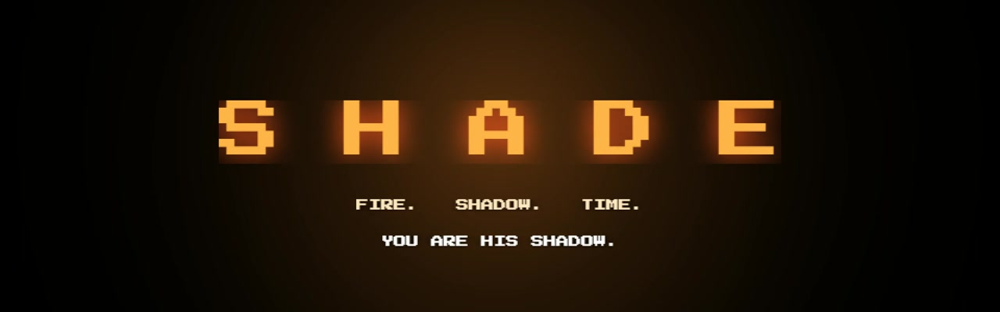
</p>

<p align="center">
  <a href="https://github.com/zaynabtauqeer/SHADE/releases/latest"></a>
  <a href="https://claude.ai/artifact/JyV3HBAgFuCkhDnzzM6NGt"></a>
</p>

<p align="center">
  
  
  
  
  
  
</p>

<h3 align="center"><i>A scared kid. One candle. One terrifying night.<br>You are his shadow.</i></h3>

Every night at 11:00 PM, little Milo lights one candle and walks through his house of nightmares.
He is not alone. **You are his shadow** — and in the candlelight you can become anything:
a giant, a wolf, a storm of ravens. Keep his flame alive, smash the creatures of the dark,
and **stop time itself** as the clock ticks toward midnight, when the Hollow is waiting.

<p align="center">
  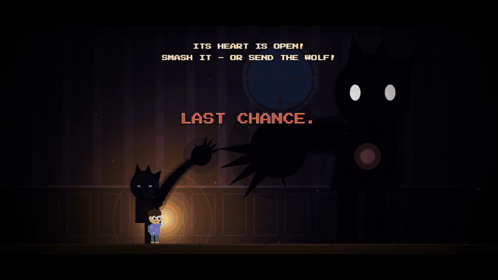
</p>

## 📸 Screenshots

<table>
  <tr>
    <td>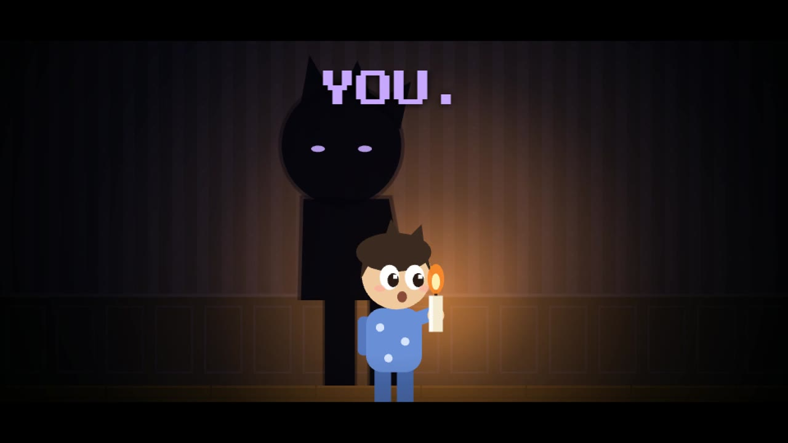</td>
    <td>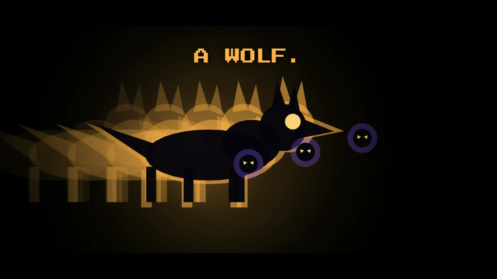</td>
    <td>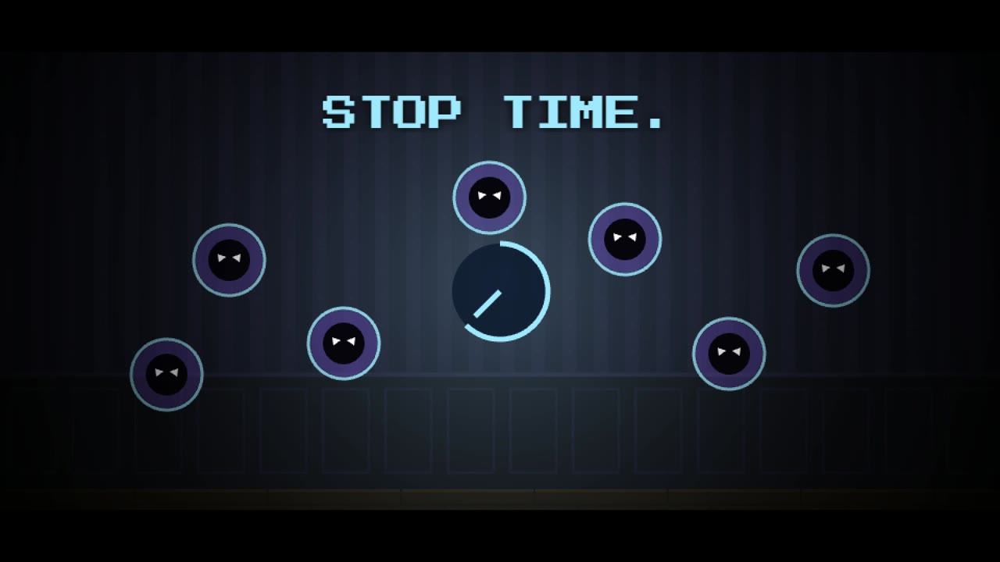</td>
  </tr>
  <tr>
    <td>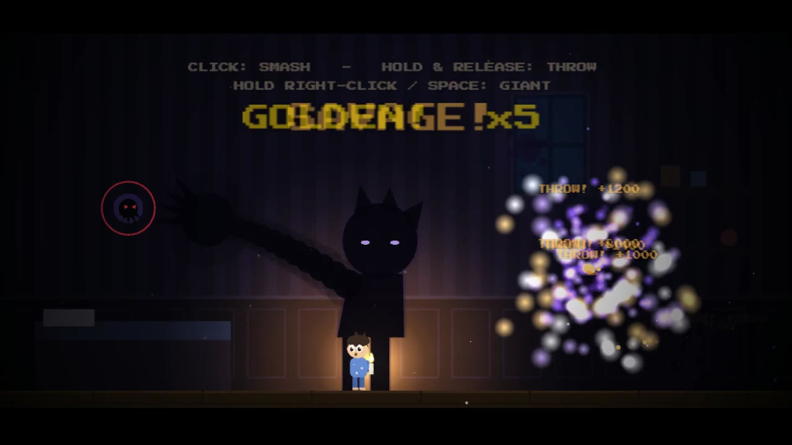</td>
    <td>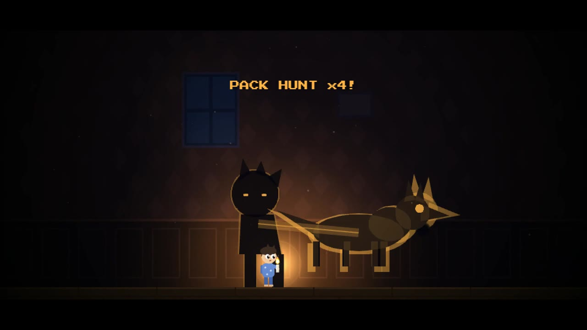</td>
    <td>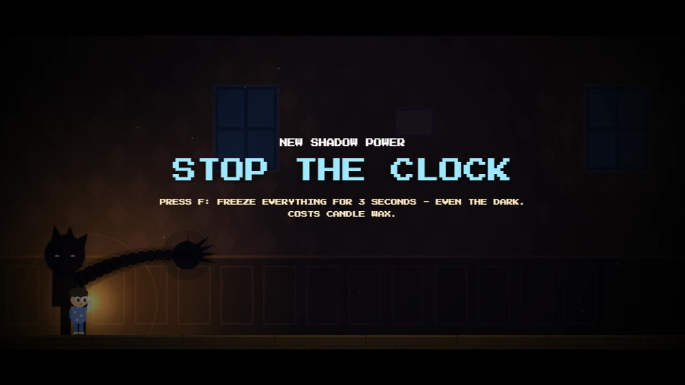</td>
  </tr>
  <tr>
    <td>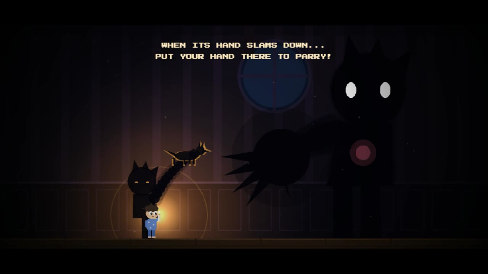</td>
    <td>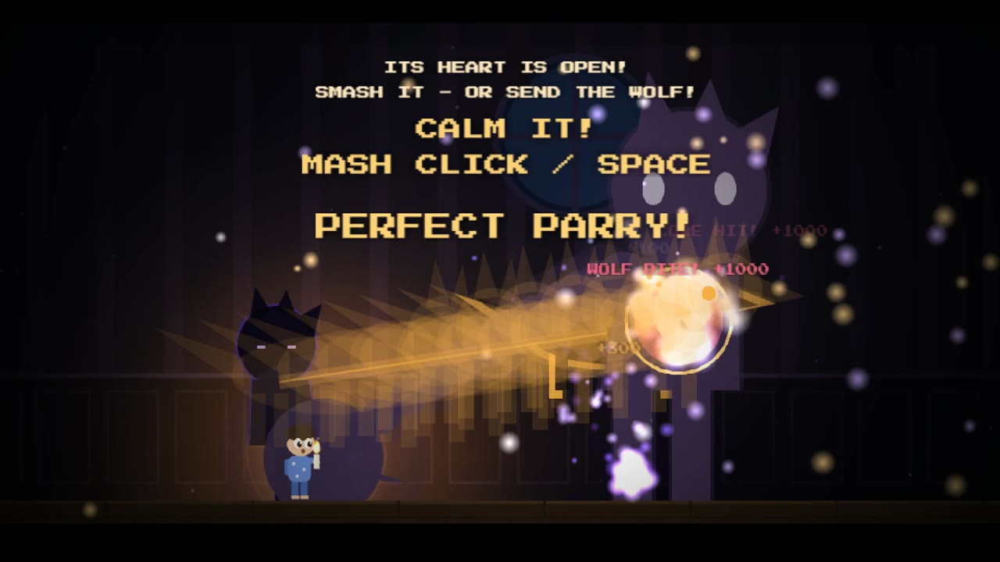</td>
    <td>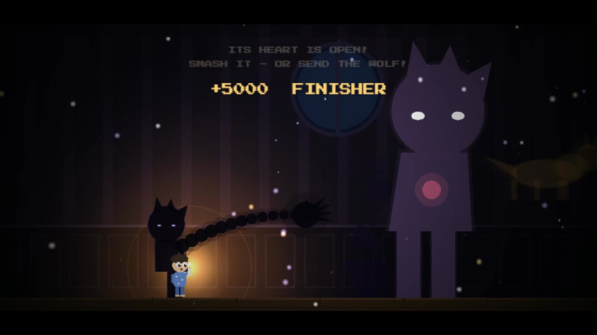</td>
  </tr>
</table>

## ▶ Play it

| Platform | How |
|---|---|
| **Windows** | Download **`SHADE-windows-x64.zip`** from [Releases](https://github.com/zaynabtauqeer/SHADE/releases/latest) → unzip → double-click **`SHADE.exe`** |
| **macOS (Apple Silicon M1/M2/M3/M4)** | Download **`SHADE-mac-arm64.zip`** from [Releases](https://github.com/zaynabtauqeer/SHADE/releases/latest) → unzip → see *Mac note* below |
| **macOS (Intel)** | Download **`SHADE-mac-x64.zip`** from [Releases](https://github.com/zaynabtauqeer/SHADE/releases/latest) → unzip → see *Mac note* below |
| **Any browser** | Open `game/index.html` (or run `python -m http.server` in `game/` and visit `localhost:8000`) |

The executables work fully **offline** (the engine and font are bundled).

**Mac note:** the app is not signed by Apple, so macOS may say it "can't be opened" or "is damaged".
Open **Terminal** in the folder where you unzipped it and run:

```bash
xattr -cr SHADE.app && open SHADE.app
```

(or right-click `SHADE.app` → **Open** → **Open**).

## 🎮 Controls

| Key | Action |
|---|---|
| **Mouse** | Move your shadow hand |
| **Click** | Smash |
| **Hold click + let go** | Grab & throw |
| **Right-click / Space** | Giant shadow |
| **1 · 2 · 3** | Switch form: Hand / Wolf (dash attack) / Raven (homing storm) |
| **F** | **STOP TIME**: freezes every enemy for 3 s (costs wax) |
| **A / D or ← / →** | Guide Milo through the dark (Basement room) |
| **1 – 7** (title screen) | Jump straight to a room — e.g. **7** for the boss |
| **ESC / P** | Pause (shows all controls) · **R** restart room · **X** quit |
| **🔊 button** | Mute |
| **F11** | Fullscreen (desktop app) |

The game also teaches every control in-game with one-time tips, and the title screen has a full *HOW TO PLAY* panel.

## 🔥🌑⏳ How the themes fit together

- **Fire** — Milo's candle is your life bar. Its *wax* fuels your powers, embers refill it, wind gusts try to blow it out, and the flame is the only light in the house.
- **Shadow** — you *are* the shadow the candle casts. Your forms (hand, wolf, ravens) only exist in its light; darkness rooms hide the monsters, and the final boss is the Hollow, a shadow without a child.
- **Time** — every room is a time on the clock between 11:00 PM and midnight. **STOP TIME** (F) freezes monsters, the wall of darkness and even the boss, and the Hollow gets faster the longer the fight runs.

## 🗺 The night (7 rooms)

1. **11:00 · The Bedroom** — learn to be a shadow
2. **11:15 · The Hallway** — become the wolf
3. **11:25 · The Storm Window** — shield the flame from the wind
4. **11:35 · The Library** — become a storm of ravens
5. **11:45 · The Stairs** — outrun a wall of darkness and learn to STOP TIME
6. **11:52 · The Basement** — fight what you cannot see
7. **11:59 · The Attic** — the Hollow at midnight: parry, freeze time, hit the heart

Golden nightlings, combos, close calls, S/A/B room ranks and a saved high score keep every run tense.

## 🛠 Tech

- **Engine:** [Phaser 3.80.1](https://phaser.io) (MIT), bundled in `game/vendor/`
- **Art:** 100% procedural — every character and effect is drawn in code, no image files
- **Audio:** 100% synthesized live with the Web Audio API (haunted music + sound effects), no audio files
- **Font:** [Press Start 2P](https://fonts.google.com/specimen/Press+Start+2P) (SIL Open Font License)
- **Desktop builds:** Electron 33 (`desktop/`)
- Built by vibe-coding with AI assistants.

## 📁 Repo layout

```
game/        the whole game — index.html + vendor/ (Phaser, font)
desktop/     Electron wrapper + build scripts for the Windows / macOS executables
```

**Rebuild the executables:** `cd desktop && npm install && node build.js` (Windows build) then `python make_mac.py` (macOS builds). Output goes to `dist/`.

## 🎬 Trailer

See the submission form (Google Drive link).
